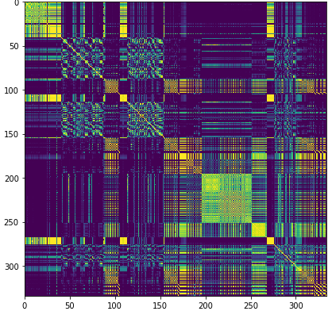
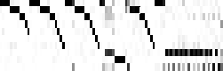
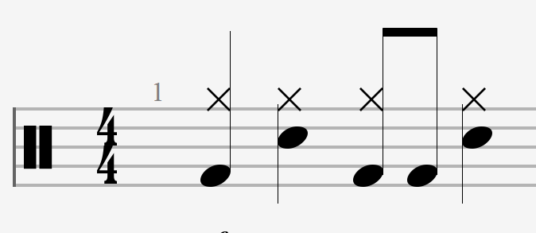

## Test {.test-slide}

<!-- EXPECT: the clicker / sound check slide shown before the talk. Not counted: the counter reads
     "test slide", and the next slide is 1. (Its content is free: three clicks and a sound to try
     the clicker and the speakers; clicks and sounds are checked on their own slides.) -->

[Sound check]{audio=media/media5.mp3}

::: {.absolute .tb .body .incremental left=144 top=240 width=1008 height=376}
- First
- Second
- Third
:::

## {.title-slide}

<!-- EXPECT: title slide built from the YAML (title, author, institute, subtitle, date) and
     talk: title-slide (note, logos): accent background, frame corners top left and bottom
     right, title in capitals, "Axel Marmoret, IMT Atlantique, Test deck", the note in
     italics, "November 5, 2026", two logos bottom left; no bar, no Quarto title block.
     Slide number 1. -->

## Feature tour

<!-- EXPECT: Markdown content starts under the title; inline and display maths (KaTeX, offline);
     speaker notes (press S). Slide number 2. -->

- Plain Markdown slides work as usual: bullets, **bold**, *italic*, [underlined]{.underline}, `code`.
- Inline maths $X \approx WH$ and display maths:

$$\mathcal{X} \approx \mathcal{G} \times_1 W \times_2 H \times_3 Q$$

- Keys during the talk: **A** stops every sound, **R** shows the highlight areas, **S** the notes.

::: notes
Speaker notes (press S).
:::

## Outline {.toc-slide}

<!-- EXPECT: basic table of contents, filled automatically: one numbered entry per section
     (every .section-header of the deck except the one marked .no-toc: "First section" and
     "A long section title (Short name)", not "Simple section style"), its title (a link to
     the section) and, smaller, its summary (the panel text of the summary slide, else the header
     subtitle). Basic look: restyle it with .talk-toc / .toc-item / .toc-title / .toc-summary. -->

## Writing a slide: defaults first

<!-- EXPECT: plain Markdown gives the usual layout with no attribute at all: title at its place,
     text and lists in the content area (20 pt, master bullets), which runs to 60 px from the
     right edge, i.e. to the right border of the upper-right box (the first item wraps after
     "template I"). The positioned boxes use short attributes only: upper right, 16 pt,
     accent colour; a framed PowerPoint-like text box (.tb: 18 pt, inner margin) with an accent
     border, text centred; at the bottom left a rounded accent box at 50 % opacity with an inner
     padding. No style= anywhere. -->

- Write Markdown: the default place, size and bullets come from the original PPT template I was using.
  - sub-items too
- Position only what is special:

::: {.absolute top=40 right=60 width=330 size=16 color=accent align=right}
`.absolute top=40 right=60 width=330 size=16 color=accent align=right`
:::

::: {.absolute .tb left=144 top=470 width=560 border="2px solid accent" align=center}
`.tb` text box, `border="2px solid accent" align=center`
:::

[`background=accent opacity=0.5 radius=12 padding="10px 20px"`]{.absolute left=144 top=580 size=14 background=accent opacity=0.5 radius=12 padding="10px 20px"}

::: {.absolute left=760 top=470 width=400 size=14}
Attributes: `left top right bottom width height` (px), `size` (pt), `color background`
(CSS or theme names `text title accent background bar`), `align`, `border`, `radius`,
`line-height`, `padding`, `opacity`. Text boxes: `.tb` (18 pt), `.tb.body` (20 pt), `.tb.ttl`
(44 pt, title colour).
:::

## Title placed by hand {top=40 left=400 size=32}

<!-- EXPECT: the title is higher (top=40), further right (left=400) and smaller (32 px) than on
     the other slides; the content below is not moved. -->

- `## Title {top=40 left=400 size=32}` (also `width=`): the PowerPoint title box, placed by hand.

## Push transition {push=up}

<!-- EXPECT: entering this slide, PowerPoint "Push": the previous slide and this one move up
     TOGETHER (no empty gap, no lag), in 0.8 s; going back, they move down together. -->

- `## Title {push=up}`: `up`, `down`, `left`, `right`; duration: YAML `talk: push-duration` (0.8 s)
- Other native reveal transitions (`transition=`) still work.

## Background colour {background-color="#F4F1EA"}

<!-- EXPECT: this slide has a lighter background (native Quarto attribute background-color="…"
     on the heading); the whole deck's colour is YAML talk: colors: background. -->

- Deck: `talk: colors: background: "#EBE7DD"` (YAML)
- One slide: `## Title {background-color="#F4F1EA"}` (native Quarto; also `background-image=`)

## No left bar {.nobar}

<!-- EXPECT: no vertical bar on the left of this slide (.nobar); everything else as usual. -->

- `## Title {.nobar}`: the vertical bar on the left is hidden on this slide.

## Grid boxes: one box, several cells

<!-- EXPECT: every bar and the matrix are ONE box each, cut into cells by thin lines (no double
     lines). Bar 2 (cols="2 2 2 2 2 2 1 1 2 2 2") has two narrow cells "d" "e". The matrix cells are
     coloured from light to dark (cells=). Click 1: the last cell of bar 3 appears as a whole,
     text "B'" and accent background together ([B']{.cell .fragment background=accent}), the lines
     staying in place. -->

::: {.absolute left=144 top=200 width=200 size=16 align=right}
Row labels
:::

::: {.absolute left=360 top=195 width=790 height=45 border="1px solid text" cols=5 lines=true}
- One
- Two
- Three
- Four
- Five
:::

::: {.absolute left=360 top=270 width=790 height=45 border="1px solid text" cols="2 2 2 2 2 2 1 1 2 2 2" lines=true}
- a
- b
- c
- c
- a
- b
- d
- e
- f
- c
- c'
:::

::: {.absolute left=360 top=345 width=790 height=45 border="1px solid text" cols=5 lines=true}
- A
- B
- A
- C
- [B']{.cell .fragment background=accent}
:::

::: {.absolute .box left=150 top=420 width=150 height=120 cols=3 rows=3 lines=true cells="shade1 shade2 shade3 shade2 shade3 shade4 shade3 shade4 shade5"}
:::

::: {.absolute left=340 top=420 width=820 size=14}
`cols=` / `rows=`: a number of equal cells, or relative sizes (`cols="2 2 1 1"`) · `lines=true`
(or `"2px accent"`): lines between cells · a list = the text of the cells, row by row ·
`cells="c1 c2 …"`: cell colours, row by row · `[x]{.cell …}` alone in an item: attributes of the
whole cell (`.fragment`, `background=`, `hl=`, `data-id=` to morph) · `hl=`: see the highlight
slides · PowerPoint rows of touching boxes become such a box (`tools/segments.py`).
:::

## Lists: markers and levels

<!-- EXPECT: Markdown lists: four different markers for four levels (■, – italic, • smaller,
     ○ italic; a 5th level would get ►, deeper levels start again at ■), hanging indents of the
     PowerPoint master (0.42", 1", 1.5", 2"), 10 pt before a level-1 item, 5 pt before the
     others. All items shown at once. The numbered list shows 1. 2. -->

:::: {.columns gap=60}
::: {.column width="55%"}
- Level 1 item, long enough to wrap onto a second line under its own text
  - Level 2, italic
    - Level 3, smaller
      - Level 4, italic
- Another level 1 item
:::
::: {.column width="45%"}
1. Numbered
2. Lists too
   - with a sub-item
:::
::::

## Lists: other markers {.no-slide-refs}

<!-- EXPECT: left box: "•" for every level (class .b-dot); middle: per-level markers from
     bullets="✓ ➔ ○"; right: no markers and no hanging indent (.no-bullets). -->

::: {.absolute .b-dot left=144 top=200 width=330 size=18}
- `.b-dot`: dots
  - at every level
:::

::: {.absolute left=500 top=200 width=330 bullets="✓ ➔ ○" size=18}
- `bullets="✓ ➔ ○"`
  - level 2
    - level 3
:::

::: {.absolute .no-bullets left=860 top=200 width=300 size=18}
- `.no-bullets`
  - indented, no marker
:::

::: {.absolute left=144 top=470 width=1000 size=14.5}
Presets: `.b-sq .b-dash .b-dot .b-circ .b-tri .b-check .b-cross .b-arrow .b-none` (all levels) or with the level
`.b-dot0` … `.b-dot4`; per level `bullets="■ – • ○ ►"` (`none` = no marker); whole deck: YAML `talk: bullets:`;
fine control: CSS variables `--talk-bN`, `--talk-marN`, `--talk-indN`, `--talk-spcbN` (README).
:::

## Lists: check and picture markers {.no-slide-refs}

<!-- EXPECT: left: a list whose items have a green check (.yes) or a red cross (.no) as their
     marker. Right: two items whose markers are
     pictures (a question mark, an exclamation mark), 73 px wide (mark=, mark-size=73), hanging in
     the indent like a text marker, centred on the first line, the lines not pushed apart; the text
     of level 1 starts 86 px from the box's left edge and the level-2 item 50 px further, with its
     usual "–" marker (indent="86 50"); 40 pt before each level-1 item (spacing="40 5"). -->

::: {.absolute .tb .body left=144 top=200 width=420}
- [A good point]{.yes}
- [A bad point]{.no}
- [Another bad point]{.no}
:::

::: {.absolute .tb .body left=640 top=180 width=520 indent="86 50" spacing="40 5"}
- [First item]{mark=media/question.svg mark-size=73}
- [Second item]{mark=media/exclamation.svg mark-size=73}
  - *A sub-item* $(\beta = 1)$
:::

::: {.absolute left=144 top=500 width=1000 size=14}
`- [text]{.yes}` / `{.no}` (whole lists: `.b-check` / `.b-cross`) · `- [text]{mark=icon.svg mark-size=73}`: a picture
as the marker · `indent="86 50"` on the box: text of level 1 at 86 px, each deeper level 50 px further
:::

## Lists: spacing {.no-slide-refs}

<!-- EXPECT: four lists. Left: the default spacing (10 pt before a level-1 item, 5 pt before the
     others). Middle left: spacing="20 10" doubles both. Middle right: spacing=0 packs the
     items. Right: an empty line between two items ("-" alone) and a larger line-height. -->

::: {.absolute left=144 top=190 width=240 size=18}
- Default
- 10 pt before
  - 5 pt before
  - at level 2
- and so on
:::

::: {.absolute left=410 top=190 width=240 size=18 spacing="20 10"}
- `spacing="20 10"`
- 20 pt before
  - 10 pt before
  - at level 2
- and so on
:::

::: {.absolute left=676 top=190 width=240 size=18 spacing=0}
- `spacing=0`
- nothing before
  - nothing
  - at level 2
- and so on
:::

::: {.absolute left=942 top=190 width=240 size=18 line-height=1.5}
- `line-height=1.5`
- an empty line:
-
- `-` alone
- and so on
:::

::: {.absolute left=144 top=560 width=1040 size=14.5}
`spacing="A B"` = space before level-1 items / before deeper items, in pt (one value: every level);
`line-height=` = line spacing; `-` alone = an empty line (indent it for a deeper level); whole deck:
CSS variables `--talk-spcbN` (before), `--talk-spca` (after), `--talk-list-lh`.
:::

## Lists: clicks {.no-slide-refs}

<!-- EXPECT: left (native .incremental): every item, sub-items included, is its own click
     (clicks 1-4), its marker appearing with it. Right (.incremental levels=1, PowerPoint
     "by 1st level paragraphs"): each level-1 item appears with its sub-items (clicks 5-6).
     Items without incremental are shown at once (previous slides). -->

::: {.absolute .incremental left=144 top=200 width=480}
- One
  - one.a
- Two
  - two.a
:::

::: {.absolute .incremental left=680 top=200 width=480 levels=1}
- Three
  - three.a
  - three.b
- Four
  - four.a
:::

## Columns

<!-- EXPECT: three columns of equal width, 40 px apart (default gap), a thin line in the middle of
     each gap (lines=true); below, two columns 30 % / 70 % with gap=80, both 200 px tall: the left
     one's two blocks spread evenly over that height (valign=spread), the right one's text sits at the
     bottom (valign=bottom). Native Quarto syntax, plus gap= / lines= on .columns and height= /
     valign=top|center|bottom|spread on a column. -->

:::: {.columns lines=true}
::: {.column}
- One
- Three equal columns
:::
::: {.column}
- Two
- no width given
:::
::: {.column}
- Three
- `lines=true`
:::
::::

&nbsp;

:::: {.columns gap=80}
::: {.column width="30%" height=200 valign=spread}
`width="30%"`, `gap=80`

`valign=spread height=200`
:::
::: {.column width="70%" height=200 valign=bottom}
`:::: {.columns gap=80}` then one `::: {.column width=…}` per column (any content: lists, pictures, boxes, maths); `valign=bottom` puts this text at the bottom.
:::
::::

## Cards

<!-- EXPECT: three cards (title bar in the shape style, framed body with "•" items, text centred
     vertically), the same height; the third one appears at click 1 and has a footer in the light
     accent colour. -->

::: {.absolute .columns left=144 top=170 width=1000 gap=40}
::: {.column .card height=280}
### Card one
- A list
- in the body
:::
::: {.column .card height=280 align=center}
### Card two
Plain text, centred
:::
::: {.column .card .fragment height=280 fragment-index=1}
### Card three (click 1)
- With a footer

::: {.card-foot}
*Footer*
:::
:::
:::

::: {.absolute left=144 top=520 width=1000 size=14}
`::: {.card}` `### Title` body `::: {.card-foot} … :::` `:::` · `::: {.column .card}` in a row of columns
(the cards share the row's height) · alone: `.absolute left= top= width= height=`
:::

## Separators

<!-- EXPECT: a 1 px black horizontal line, a thick vertical accent line and a dashed cyan
     vertical line (one .sep each, no arrow shortcode, no style=). -->

[]{.sep .absolute left=144 top=220 width=1000}
[]{.sep .absolute left=300 top=260 height=240 thickness=6 color=accent}
[]{.sep .absolute left=600 top=260 height=240 thickness=4 color=cyan dash="12 8"}

::: {.absolute left=144 top=540 width=1000 size=14}
`[]{.sep .absolute left= top= width=600}` (horizontal) or `height=300` (vertical) · `thickness=` (1 px) ·
`color=` (black) · `dash="12 8"` (dashed) · clicks and classes as usual
:::

## Captioned pictures

<!-- EXPECT: two pictures, each with its name just above, centred on the picture whatever
     the picture's width= / height= (the box has no width), in the box's font (size=, color=),
     not Quarto's small grey caption; the second has its caption below. Each is ONE native
     figure: the box gives the place, the caption hangs outside the picture. -->

::: {.absolute .caption-top left=200 top=260 size=18}
{width=300 height=300}
:::

::: {.absolute .caption-bottom left=620 top=260 size=18 color=accent}
{width=200 height=230}
:::

## Boxes and shapes

<!-- EXPECT: top row: a framed .box "Q", a .filled box "Filled" (accent fill, dark outline, light
     text), a .filled arrow-right "Arrow", a down arrow. Bottom row: a parallelogram, a cube with "𝒳"
     in its front face, and a long thin arrow with a short head (head=15 shaft=30, in % of the
     box). -->

[$Q$]{.absolute .box left=150 top=200 width=90 height=70}
[Filled]{.absolute .filled left=290 top=200 width=140 height=70}
[Arrow]{.absolute .filled left=480 top=200 width=150 height=70 shape=arrow-right}
[]{.absolute .filled left=680 top=190 width=50 height=90 shape=arrow-down}
[$Q$]{.absolute .box left=150 top=360 width=120 height=70 shape=parallelogram}
[$\mathscr{X}$]{.absolute .box left=320 top=330 width=160 height=130 shape=cube depth=30}
[]{.absolute .filled left=540 top=375 width=300 height=40 shape=arrow-right head=15 shaft=30}

::: {.absolute left=150 top=520 width=1000 size=14}
`.box` (framed) · `.filled` (accent shape style) · `shape=arrow-right|arrow-left|arrow-up|arrow-down|shrink|grow|parallelogram|cube`
· `head= shaft=` (%) · `taper=` (%) · `slant=` (%) · `depth=` (px) · `background=` fill, `border=` outline
:::

## Block diagrams

<!-- EXPECT: a horizontal .flow X → Encoder (trapezoid narrowing) → Q → Decoder (widening) → X̂,
     boxes centred vertically, "ft" dimension arrows left of X and right of X̂ (dim-left /
     dim-right), the labels of the narrow boxes turned a quarter turn: X and Q read bottom-up
     (.rot-l), X̂ top-down (.rot-r); a KaTeX arrow labelled a(). -->

::: {.absolute .flow left=180 top=220 width=900 height=280 size=18 gap=20}
[$X_i^T$]{.box .rot-l width=42 height=100% dim-left="ft"}
[Encoder]{shape=shrink width=150 height=90% taper=30%}
[$Q_i^T$]{.box .rot-l width=42 height=70}
$\xrightarrow{\;a()\;}$
[Decoder]{shape=grow width=150 height=90% taper=30%}
[$\hat{X}_i^T$]{.box .rot-r width=42 height=100% dim-right="ft"}
:::

::: {.absolute left=180 top=560 width=900 size=14}
`::: {.absolute .flow left= top= width= height= gap=}` + one box per item (spans), laid out in a row
· `.rot-l` / `.rot-r`: content turned a quarter turn
:::

## Matrices and tensors {auto-animate=true}

<!-- EXPECT: a matrix "X" (6 rows, lines) with its dimension arrows b (left, up) and tf (bottom,
     right) and their labels in maths, 14 pt (dim-size=14; 18 pt elsewhere); a cube "𝒳" with f (left
     of the front face), t (under it) and b along the top-left edge; a parallelogram "Q" with b along
     its slanted side and r_b under it; a 6-cell bar whose cells are coloured (cells=) with its f / t
     arrows. On the next slide (morph) the cells of the bar fly into the slices of a stack and the
     f / t arrows glide with them (the same morph-id "bar" on the bar, on its arrows and on the
     stack). -->

[$$X$$]{.absolute .box left=144 top=200 width=300 height=110 rows=6 lines=true dim-left=b dim-bottom=tf dim-size=14}

::: {.absolute .tb left=560 top=180 width=200 height=160 align=center shape=cube depth=50 dim-left=f dim-bottom=t dim-depth=b valign=center}
$\mathscr{X}$
:::

[$$Q$$]{.absolute .tb left=900 top=190 width=90 height=80 align=center shape=parallelogram slant=45 dim-depth=b dim-bottom="r_b" valign=center}

::: {.absolute left=144 top=420 width=360 height=110 border="1px solid black" cols=6 lines=true cells="shade1 shade2 shade3 shade4 shade5 shade6" morph-id=bar}
:::
[]{.absolute left=144 top=420 width=60 height=110 dim-left=f dim-bottom=t morph-id=bar}

::: {.absolute left=560 top=400 width=600 size=14}
`[$X$]{.absolute .box … rows=6 lines=true dim-left=b dim-bottom=tf}` · on a cube / stack also
`dim-depth=`, on a parallelogram the depth arrow follows the slanted side · `dim-top=`, `dim-right=`
· labels are maths (`r_b` → $r_b$; `$…$` or text otherwise), `dim-size=` pt · `morph-id=P` names the
parts a box generates for a Morph: its cells (P-1, P-2…), its stack slices (P-1…), its arrows (P-left…)
:::

## Matrices and tensors {auto-animate=true}

[]{.absolute .box left=400 top=300 width=60 height=110 stack="shade1 shade2 shade3 shade4 shade5 shade6" depth=80 lift=70 dim-left=f dim-bottom=t dim-depth=b morph-id=bar}

::: {.absolute left=560 top=300 width=600 size=14}
`[]{.absolute .box … stack="c1 … cn" morph-id=P depth=80 lift=70 dim-left=f dim-bottom=t dim-depth=b}`:
a stack of n slices (the first one in front, the others `depth` px to the right and `lift` px up).
:::

## Arrows

<!-- EXPECT: a thin black arrow, a bent arrow (one waypoint,
     sharp corner: smooth=false) and a connector with a dot at its start (head=circle head-start)
     are always visible; at click 1 an accent arrow is drawn (fragment=true). -->






::: {.absolute left=150 top=540 width=1000 size=14}
`` (slide px; quarto-arrows extension): `width=` `size=`
(head) `color="var(--talk-accent)"` / `"var(--hl-NAME)"` `head=circle|…` `head-start=` `head-end=` · a line without head is a `.sep`
`waypoints="x,y …" smooth=false` `fragment=true fragment-index=N`
:::

## Diagrams

<!-- EXPECT: a Mermaid diagram X → Encoder → Q → 𝒢 (theme colours, KaTeX maths, script G) fills
     its box, centred. -->

::: {.absolute left=300 top=170 width=680 height=500}
```{mermaid}
flowchart LR
  X["$$X_i^T$$"] --> E[\"Encoder"/] --> Q["$$Q_i^T$$"] --> G[/"$$\mathscr{G}_{(2)}^T$$"\]
```
:::

## Side panel,<br>in brief {.side-panel}

<!-- EXPECT: static left panel in the accent colour, closed by a black line; no transition.
     The picture positioned over the panel stays above it. -->

::: {.section-panel}
Text in the panel
:::

- Same panel as a section summary, without the transition
- Content positioned on the panel stays above it:

{.absolute left=120 top=420 width=233 height=93}

## First section {.section-header}

<!-- EXPECT: header = full-screen framed block; next slide = summary. The block shrinks into the
     left panel, the frame keeps only its right border, title words glide, words present in only
     one title fade in place. Same in reverse. Header and summary share one slide number.
     The own citation label is bold. In the panel, the text block is centred between the left
     edge and the closing line (36 px on each side). -->

Subtitle with a citation [@marmoret2022barwise]

## First section {.section-summary}

::: {.section-panel}
Subtitle with a citation [@marmoret2022barwise]
:::

Slide content, right of the panel; the block shrinks and uncovers it.

## A long section title (Short name) {.section-header color="#9A5D78" duration=1.6 border-width=8px title-size=54px}

<!-- EXPECT: per-slide options: purple block, thinner frame, slower morph; "A long
     section title ( )" fades in place while "Short name" moves; explicit reference text.
     The summary's wider panel (520 px) gets a larger title and subtitle (50 → 59 px, 24 → 28 px:
     they follow panel-width unless summary-title-size / panel-subtitle-size are given). -->

Options on the heading override the YAML defaults

::: {.section-ref}
An explicit reference line (replaces the automatic one)
:::

## Short name {.section-summary panel-width=520px}

::: {.section-panel}
Wider panel (panel-width=520px)
:::

The summary inherits the header's options.

## Simple section style {.section-header section-style=simple .no-toc}

<!-- EXPECT: "simple" section: the framed colour block with the title only (the subtitle and
     the reference line are dropped), no morph, no summary slide. Choose it per section
     (section-style=simple|full) or for the deck (YAML talk: section: style: simple).
     (A .section-summary written after a simple header is kept as an ordinary slide.)
     Not listed in the outline (.no-toc). -->

Subtitle (not shown in the simple style) [@marmoret2022barwise]

## Morph (auto-animate) {auto-animate=true}

<!-- EXPECT: on the next slide, boxes with the same data-id move and resize smoothly; the
     filled arrow (a shape box rotated 90°, pointing down) keeps its rotation during and after
     the morph (the data-id and the position are on the outer div, the rotation on the inner box);
     the highlighted image keeps its highlight; the three cells of the divided box (one box, thin
     lines) fly apart into three separate boxes (each cell has its own data-id). Native
     Quarto/reveal feature. -->

::: {.absolute .box left=150 top=260 width=120 height=160 background=background data-id=slice1}
$X_1$
:::

::: {.absolute .box left=300 top=260 width=120 height=160 background=background data-id=slice2}
$X_2$
:::

:::: {.absolute left=500 top=300 width=120 height=60 data-id=arrow}
[]{.absolute .filled left=0 top=0 width=120 height=60 shape=arrow-right style="transform:rotate(90deg)"}
::::

{.absolute left=700 top=260 width=270 height=117 data-id=picture hl="0-@(37.8,30,6.3,19)"}

::: {.absolute left=150 top=500 width=360 height=60 border="1px solid text" cols=3 lines=true}
- [1]{.cell data-id=slice-a}
- [2]{.cell data-id=slice-b background=accent}
- [3]{.cell data-id=slice-c}
:::

## Morph (auto-animate) {auto-animate=true}

::: {.absolute .box left=150 top=200 width=80 height=100 background=background data-id=slice1}
$X_1$
:::

::: {.absolute .box left=170 top=220 width=80 height=100 background=background data-id=slice2}
$X_2$
:::

:::: {.absolute left=400 top=450 width=120 height=60 data-id=arrow}
[]{.absolute .filled left=0 top=0 width=120 height=60 shape=arrow-right style="transform:rotate(90deg)"}
::::

{.absolute left=640 top=330 width=540 height=234 data-id=picture hl="0-@(37.8,30,6.3,19)"}

::: {.absolute .box left=640 top=600 width=100 height=60 data-id=slice-a}
1
:::

::: {.absolute .box left=770 top=600 width=100 height=60 background=accent data-id=slice-b}
2
:::

::: {.absolute .box left=900 top=600 width=100 height=60 data-id=slice-c}
3
:::

## Clicks: groups and exits

<!-- EXPECT: click 1: the boxes A and B appear together (one click group); click 2: "only at
     click 2" appears; click 3: it disappears again (.fade-in-then-out) and "gone at click 3"
     disappears (.fade-out). -->

::: {.fragment fragment-index=1}
[A]{.absolute .box left=150 top=220 width=80 height=60}
[B]{.absolute .box left=250 top=220 width=80 height=60}
:::

[only at click 2 (`.fade-in-then-out`)]{.absolute .tb .fragment .fade-in-then-out left=150 top=330 size=22 fragment-index=2}

[gone at click 3 (`.fade-out`)]{.absolute .tb .fragment .fade-out left=150 top=400 size=22 fragment-index=3}

::: {.absolute left=150 top=520 width=1000 size=14}
One block per click: `::: {.fragment fragment-index=N}` around every object of that click · `.fade-in-then-out`:
that click only (click N+1 must exist) · `.fade-out`: shown until click N
:::

## Clicks: timing

<!-- EXPECT: "fades out by itself" is visible when the slide arrives and fades out 0.8 s later
     (.fade-after); "fades out after 3 s" does the same 3 s after the arrival (fade-delay=3).
     Click 1: "B" appears, and "C" 2 s later by itself (delay=2, PowerPoint "after previous" +
     delay); going back hides both at once. -->

[fades out by itself (`.fade-after`)]{.absolute .tb .fade-after left=150 top=200 size=22 color=accent}
[fades out after 3 s (`fade-delay=3`)]{.absolute .tb .fade-after left=650 top=200 size=22 color=accent fade-delay=3}

[B (click 1)]{.absolute .tb .fragment left=150 top=320 size=22 fragment-index=1}
[C (click 1, 2 s later: `delay=2`)]{.absolute .tb .fragment left=450 top=320 size=22 fragment-index=1 delay=2}

::: {.absolute left=150 top=520 width=1000 size=14}
`delay=S` on a fragment: appears S s after its click · `delay=move` / `delay=end`: after a motion path /
a sound (their slides) · `.fade-after`: shown when the slide arrives, fades out by itself (`fade-delay=S`)
:::

## Motion paths

<!-- EXPECT: click 1: the three grey bars and the box slide 300 px left together (one .move
     around them, dx=-300), and "arrived" appears only once they have arrived (delay=move). Going
     back, they return at once. -->

::: {.fragment .move fragment-index=1 dx=-300}
[]{.absolute left=800 top=200 width=200 height=20 background="#999"}
[]{.absolute left=800 top=230 width=200 height=20 background="#bbb"}
[]{.absolute left=800 top=260 width=200 height=20 background="#ddd"}
[moves at click 1]{.absolute .box left=800 top=310 width=200 height=70}
:::

[arrived (`delay=move`)]{.absolute .tb .fragment left=150 top=430 size=22 fragment-index=1 delay=move}

::: {.absolute left=150 top=540 width=1000 size=14}
`::: {.fragment .move fragment-index=N dx= dy=}` around the objects (px) · `delay=move` on a fragment of the
same click: it appears when the move has ended
:::

## Recap: the built slide

<!-- EXPECT: a small diagram built click by click from an included file (include shortcode, _recap.qmd):
     "Step one" at once, click 1 an arrow and "Step two", click 2 an arrow and "Step three", and the
     note "(only at click 1)" shown at click 1 only. -->



## Recap: everything at once

<!-- EXPECT: the same included diagram inside ::: {.static}: everything shown at once, no click
     on this slide; the note "(only at click 1)" is dropped (an object that ends hidden). -->

::: {.static}

:::

[`::: {.static}` `` `:::`]{.absolute left=150 top=600 size=14}

## Audio: buttons

<!-- EXPECT: icon 1 plays on click; icon 2 plays when the slide opens (after 0.5 s); icon 3
     appears and plays at click 1; icon 4 loops at 60 % volume, with its label; the scissors
     picture is itself a play button (audio= on the image). A stops everything; blocked sounds turn red. -->

- Click to play: [Sound one]{audio=media/media5.mp3}
- Plays when the slide opens (`play=0 delay=0.5`): []{audio=media/media6.mp3 play=0 delay=0.5}
- Appears and plays on click 1 (`.fragment play=1`): []{.fragment audio=media/media10.mp3 play=1}
- Loop, volume, label: [Sound two]{audio=media/media11.mp3 loop=true volume=0.6}
- A picture can be the button (`audio=` on it):

{.absolute left=900 top=440 width=60 height=60 audio=media/media12.mp3}

## Audio: sounds at clicks

<!-- EXPECT: no sound when the slide opens. Click 1 starts the "Sound two" sound (play=1 on its
     icon); click 2 stops all sounds ([]{stop=2}); click 3 plays the
     sound of the last icon (play=3), and its "→ …" text appears only when that sound ends
     (delay=end, about 4 s; at once if A stops it); going back hides it. -->

- Started by click 1: [Sound two]{audio=media/media11.mp3 play=1}
- Stopped by click 2
- Plays at click 3 (`play=3`): []{audio=media/media2.mp3 play=3} [→ shown when the sound ends (`delay=end`)]{.fragment fragment-index=3 delay=end}

[]{stop=2}

## Audio: icons in columns

<!-- EXPECT: the speaker icons of each item are aligned in two columns, 300 px and 380 px from
     the text's left edge, on the first line of their item (audio-col="300 380"), whatever the
     length of the item's text. -->

::: {.absolute .tb .body left=144 top=200 width=700 audio-col="300 380"}
- Short []{audio=media/media5.mp3} []{audio=media/media6.mp3}
  - a sub-item
- A longer item []{audio=media/media11.mp3}
:::

::: {.absolute left=144 top=460 width=1000 size=14}
`audio-col="x1 x2"` on the box: the icons of each item (`[]{audio=…}`) sit x px from the text's left edge
:::

## Citations

<!-- EXPECT: labels [SB03], [KC07, **Mar+20**] with own labels in bold; the slide's references
     listed at its bottom (incl. the refs-only one); a full reference in the text. -->

- One or several: [@smaragdis2003nonnegative], [@kim2007nonnegative; @marmoret2020uncovering]
- With prefix and suffix: [see @foote2000automatic, p. 3]
- Author in text: @kim2007nonnegative showed…
- Smaller, as in the deck: text [[@marmoret2022gretsi]]{size=14}
- Full reference in the text: [@foote2000automatic]{.fullcite}
- In the list but not in the text: [[@grill2015music]]{.refs-only}

## No reference list here {.no-slide-refs}

<!-- EXPECT: the citation is shown but no list at the bottom of this slide. -->

A citation [@goto2002rwc] without the per-slide list.

## Highlights on objects

<!-- EXPECT: per click, parts of the objects turn red/coloured; text stays above the colour and
     borders stay crisp. G has lines=true: thin lines between its 3×3 cells, visible over the
     coloured cells too, and no double line along its border. Click 0 = already on when the slide
     opens. H gets a rounded halo (hl-radius=20, hl-pad=10) at click 4. Press R: every area, its
     steps and the grids are outlined. -->

::: {.absolute .box left=150 top=230 width=90 height=200 cols=3 hl="1@1; 2@2; 3-@3"}
$W$
:::

::: {.absolute .box left=300 top=230 width=200 height=200 cols=3 rows=3 lines=true hl="0@1,1; 1@2,2; 2@*,3 teal; 3-@1-2,1-2 custom"}
$G$
:::

::: {.absolute .box left=300 top=170 width=200 height=30 cols=4 hl="1@1; 2@2; 3@3; 4-@4"}
:::

::: {.absolute .box left=560 top=230 width=250 height=90 hl="4 teal" hl-radius=20 hl-pad=10 size=18}
$H$: whole object, halo
:::

::: {.absolute .box left=560 top=360 width=240 height=70 hl=1-2 hl-style=outline hl-color="#4A845E"}
outline, own colour
:::

::: {.absolute .box left=560 top=460 width=240 height=70 hl="2-3 purple" hl-shape=ellipse hl-opacity=0.8}
ellipse, opacity 0.8
:::

{.absolute left=860 top=230 width=270 height=117 hl="1@(37.8,30,6.3,19); 2-@(50.7,30,7,19) orange; 3@(10px,5px,40px,40px) green"}

::: {.absolute left=150 top=470 width=380 size=18}
Inline text too: a [highlighted phrase]{hl="2 gold"} in a sentence.
:::

::: {.absolute left=150 top=600 size=11}
`hl="STEPS@AREA COLOUR; …"` · steps `2`, `2-4`, `2-`, `0` · area: grid cell `@k`, `@c,r`, `@*,3`, `@1-2,1-2`, rectangle `@(x,y,w,h)` in % or px, nothing = whole object<br>
`cols`/`rows` (grid) · `lines` · `hl-color` · `hl-shape=round|ellipse` · `hl-radius` · `hl-pad` (halo) · `hl-opacity` · `hl-style=outline` · palette: red teal gold orange purple green brown navy black lime cyan + YAML
:::

## Sequence highlights

<!-- EXPECT: click 1: the diagonal cells of the grid get the colours in order: custom (yellow, a deck colour name),
     teal, purple, orange (hl="1-@diag …"). Click 2: the cells of the bar on the right, from left
     to right (hl="2-@cols …"). Click 3: the cells of the column, from top to bottom
     (hl="3-@rows …"). -->

::: {.absolute left=150 top=180 width=400 height=400 border="1px solid black" cols="1 1 2 1" rows="1 1 2 1" hl="1-@diag custom teal purple orange"}
:::

::: {.absolute left=650 top=180 width=400 height=60 border="1px solid black" cols=4 lines=true hl="2-@cols custom teal purple orange"}
:::

::: {.absolute left=650 top=300 width=60 height=280 border="1px solid black" rows=4 lines=true hl="3-@rows custom teal purple orange"}
:::

[`@diag c1 c2 …` (cell k,k) · `@cols …` (cells of row 1) · `@rows …` (cells of column 1)]{.absolute left=150 top=610 size=14}

## Highlights in equations

<!-- EXPECT: parts of the equation get an oval (\hlo) or a rounded box (\hl) at their clicks,
     sized to the part: click 1 X_(2) teal oval, click 2 ≈ orange oval, click 3 Q and G(W⊗H)^T
     purple. Below, coloured thick vertical ticks (\tick{colour}) in the text and in a fraction. -->

::: {.absolute left=150 top=230 width=1000 size=32}
$$\hlo[x2]{1-}{teal}{X_{(2)}} \mathrel{\hlo[approx]{2-}{orange}{\approx}} \hlo[q]{3-}{purple}{Q}\,\hl[gwh]{3-}{purple}{G_{(2)}(W \otimes H)^T}$$
:::

::: {.absolute .tb .body left=150 top=420 width=900}
- Green $\tick{lime}$, red $\tick{red}$, black $\tick{black}$: a ratio $= \frac{\tick{lime}}{\tick{red} + \tick{lime}}$
:::

::: {.absolute left=150 top=560 width=1000 size=14}
`\hl[name]{STEPS}{colour}{part}` (rounded box) · `\hlo[name]{…}` (oval) · `\eqmark{name}{part}` (a name only, for
annotations) · `\tick{colour}` · colours: palette or theme names
:::

## Annotations

<!-- EXPECT: labels with arrows point at the named parts of the equation and at a box, from
     wherever they are rendered: "no arrow, no box" under ⟺ from the start; the \eqmark label
     above ⊗ (thin arrow, no box) from the start; click 1 the teal oval and a label below it in the
     highlight's colour with a sub-label; click 2 a label above ≈; click 3 one label with two
     arrows (Q and G…); click 4 a label right of the navy box; click 5 a label at a fixed place. -->

::: {.absolute left=150 top=250 width=1000 size=32}
$$\mathrel{\eqmark{iff}{\Longleftrightarrow}} \hlo[x2]{1-}{teal}{X_{(2)}} \mathrel{\eqmark{approx}{\approx}} \eqmark{q}{Q}\,\eqmark{gwh}{G_{(2)}(W \mathbin{\eqmark{kron}{\otimes}} H)^T}$$
:::

::: {.annot to=iff pos=below dist=4 arrow=none box=false color=black}
“no arrow, no box”
:::

::: {.annot to=kron pos=above dist=40 arrow=thin box=false color=black size=18}
\\eqmark: named, not highlighted
:::

::: {.annot .fragment to=x2 pos=below dist=60 sub="(sub-label)" fragment-index=1}
pos=below, colour of the highlight
:::

::: {.annot .fragment to=approx pos=above dist=60 fragment-index=2}
pos=above
:::

::: {.annot .fragment to="q gwh" pos=below dist=70 shift=120 fragment-index=3}
two targets, two arrows
:::

::: {#demo-box .absolute .box left=150 top=520 width=160 height=90 hl="4- navy" hl-shape=round hl-pad=8}
a box
:::

::: {.annot .fragment to=demo-box pos=right dist=80 color=navy size=20 fragment-index=4}
to= an element id, pos=right
:::

::: {.annot .fragment to=demo-box x=700 y=600 color=brown size=20 fragment-index=5}
fixed place (x, y)
:::

## Annotations: arrows to the label

<!-- EXPECT: at click 1 the label "F" is placed right of the two lines and two thin accent arrows
     go FROM the right end of each line TO the label (dir=from, anchor=right). -->

::: {.absolute .tb .body left=150 top=220 width=560}
- Green $\tick{lime}$, red $\tick{red}$, black $\tick{black}$
  - [Ratio A $= \frac{\tick{lime}}{\tick{red} + \tick{lime}}$]{#eq-p}
  - [Ratio B $= \frac{\tick{lime}}{\tick{black}}$]{#eq-r}
:::

::: {.annot .fragment to="eq-p eq-r" pos=right dist=120 dir=from anchor=right arrow=thin box=false color=accent fragment-index=1}
[$F$]{color=black size=28}
:::

::: {.absolute left=150 top=540 width=1000 size=14}
`::: {.annot to="id1 id2" … dir=from anchor=right}`: the arrows point to the label, from the middle of that side
of the targets (`anchor=right|left|top|bottom`)
:::

## Edges {top=40}

<!-- EXPECT: three round nodes; at click 1 an arrow "2" from a to b (edge of circle to edge of
     circle), at click 2 arrows "5" (b → c) and "1" (a → c, label below the arrow); the score ":2"
     appears inside b at click 1. -->

[$a$]{#na .absolute .filled .nowrap left=150 top=250 width=70 height=70 color=white radius=50%}
[$b$[$\,:2$]{.fragment fragment-index=1}]{#nb .absolute .filled .nowrap left=400 top=160 width=80 height=70 color=white radius=50%}
[$c$]{#nc .absolute .filled .nowrap left=400 top=400 width=70 height=70 color=white radius=50%}

[2]{.annot .fragment from=na to=nb fragment-index=1}
[5]{.annot .fragment from=nb to=nc fragment-index=2}
[1]{.annot .fragment from=na to=nc shift=-18 fragment-index=2}

::: {.absolute left=150 top=540 width=1000 size=14}
`[label]{.annot from=ID to=ID color= width= head= shift= along= size=}` (an annotation with `from=`): an arrow from the
edge of #from to the edge of #to, the label beside its middle (`shift` px to its left, `along` px further); clicks: `.fragment`
:::

## 3D images

<!-- EXPECT: real 3D rotation (PowerPoint-like), with perspective; oblique "cube face" looks. -->

{.absolute left=110 top=230 width=233 height=93 rotate-z=-91.7 rotate-x=-35 rotate-y=-51.5}

{.absolute left=420 top=230 width=233 height=93 rotate-y=50 perspective=600 .tilt-shadow}

{.absolute left=110 top=450 width=233 height=93 face=top}

{.absolute left=420 top=450 width=233 height=93 face=side}

{.absolute left=730 top=450 width=233 height=93 face=depth depth=0.6 angle=35}

::: {.absolute left=760 top=220 width=420 size=14.5}
`rotate-x/y/z` (PowerPoint order Y, X, Z) · `perspective=600` · `.tilt-shadow`<br>
`face=top|side|depth` with `depth=` and `angle=`
:::

## Thank you! {.title-slide parts="title logos"}

<!-- EXPECT: closing slide = title slide again, with only some parts (parts="title logos"
     among title byline note date logos); the heading text replaces the YAML title. -->

::: {.appendix}
:::

<!-- ↑ APPENDIX MARKER (like LaTeX \appendix), here at the end of the last counted slide:
     every following slide is numbered additional-1, additional-2, … and left out of the total.
     The render log says: talk: appendix after the slide "Thank you!": the 3 following slides … -->

## Backup slide

<!-- EXPECT: first slide after the ::: {.appendix} ::: marker: not counted in the total; the
     counter reads "additional-1". -->

Backup material, not counted.

## Another backup slide

<!-- EXPECT: counter "additional-2". A single slide anywhere can also be {.additional}; a slide
     after the marker can opt out with {.counted}. -->

More backup material.

## References {.references-slide style="--talk-refs-size:30px"}

<!-- EXPECT: every cited work, in two columns, sorted by label, own name in bold. Written here
     at 30 px (style=, to force it; 12.5 px by default) the eight entries do not fit: the ones that
     would spill out move to a copy of this slide, "References (1/2)" then "(2/2)" (talk.js measures
     the overflow in the browser, so this holds whatever the entries' lengths). After the appendix
     marker too: counters "additional-3", "additional-4". The list is added by .references-slide
     (a ::: {#refs} ::: div would place it elsewhere). -->
